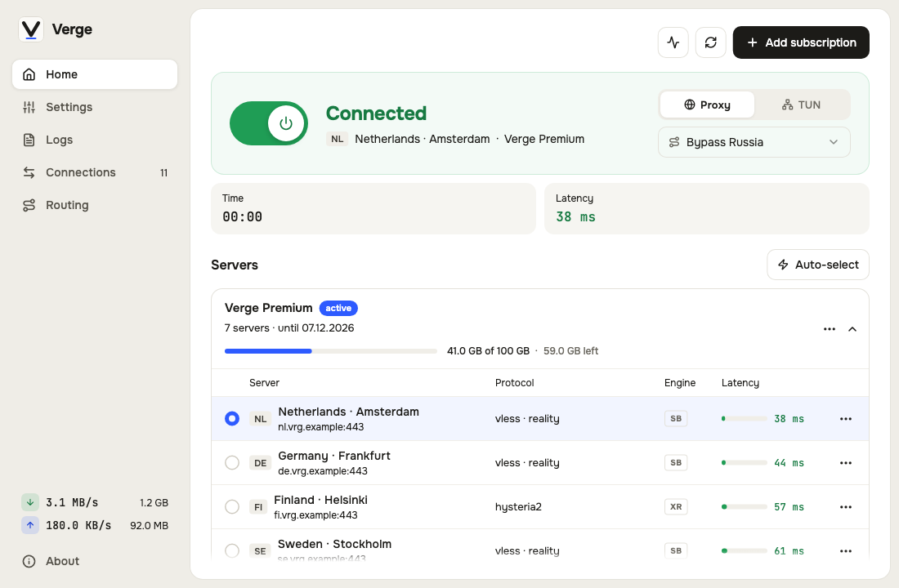
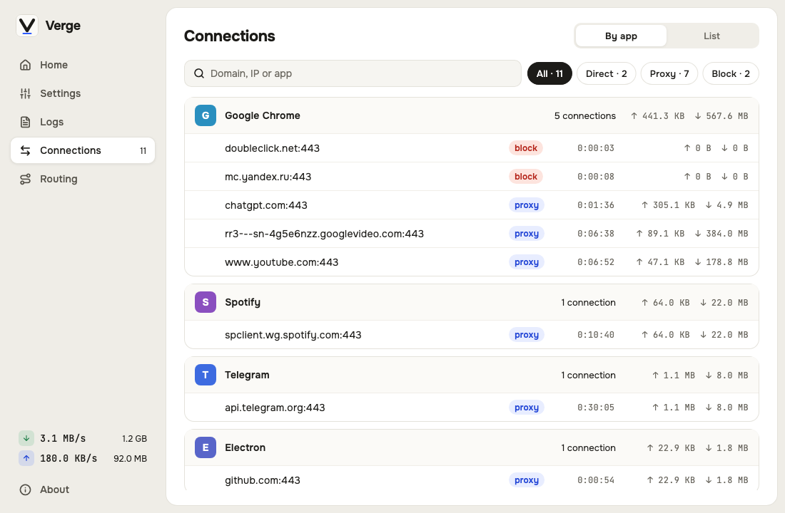
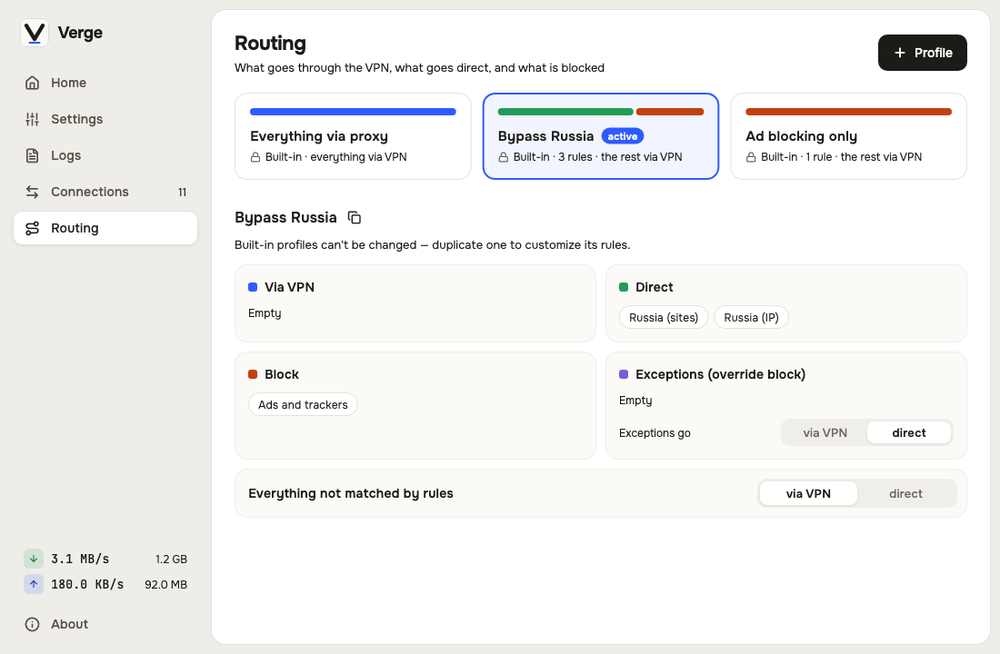
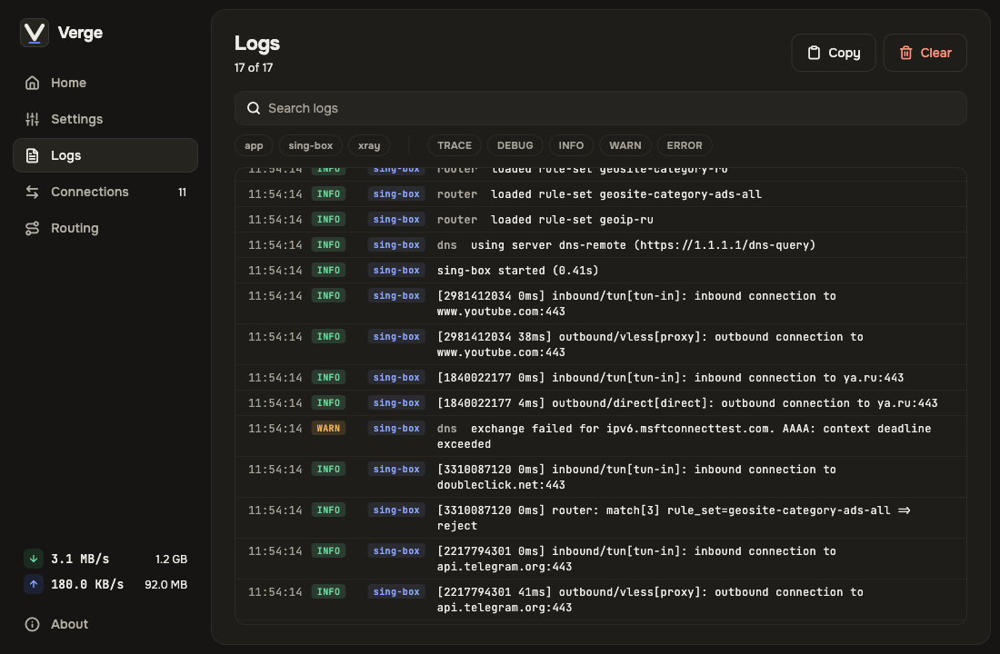
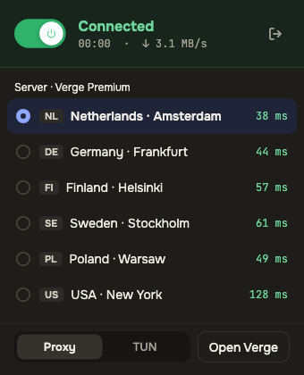

<div align="center">


# Verge

**A fast, no-nonsense proxy client for macOS and Windows**

Paste your subscription — Verge takes care of the rest.

[](https://github.com/ArtemDan1/verge_client/releases/latest)
[](https://github.com/ArtemDan1/verge_client/releases)
[](#-download)
[](LICENSE)

<br>

<picture>
  <source media="(prefers-color-scheme: dark)" srcset="docs/screenshots/home-dark.png">
  
</picture>

</div>

<br>

## 📥 Download

| Platform | Download | Requirements |
|---|---|---|
| **macOS** | [](https://github.com/ArtemDan1/verge_client/releases/latest) | Apple Silicon or Intel |
| **Windows** | [](https://github.com/ArtemDan1/verge_client/releases/latest) | Windows 10 (1809) or later |

> Builds are not signed yet. On macOS, open the installer with **right-click → Open**; on Windows, click **More info → Run anyway** in the SmartScreen dialog. Details: [macOS](docs/INSTALL.md), [Windows](docs/WINDOWS.md).

## ✨ Why Verge

⚡ **One-click connect** — add your subscription link, pick a server and press the button. No configs, no terminal.

🎯 **Server auto-select** — Verge checks latency and connects to the fastest server for you.

🧭 **Smart routing** — ready-made presets (“Everything via proxy”, “Bypass Russia”, “Ad blocking only”) or your own rules for sites and apps.

🛡 **Proxy or TUN** — just the browser and apps, or all system traffic.

⌨️ **Global hotkey** — connect or disconnect from anywhere, even when the window is hidden.

📊 **Everything in sight** — speed, traffic, active connections and the remaining subscription quota.

🔌 **Works with your panel** — sing-box, Xray and base64 subscriptions, share links, Remnawave and HWID. VLESS Reality, VMess, Trojan, Shadowsocks, Hysteria2.

🌍 **Speaks your language** — English, Русский, 简体中文, فارسی, العربية, Türkçe, Español, Português, Deutsch, Français.

🌗 **Clean interface** — light and dark themes, a tray mini-window, automatic updates; the window reopens where you left it.

## 📸 Screenshots

<table>
  <tr>
    <td width="50%"></td>
    <td width="50%"></td>
  </tr>
  <tr>
    <td align="center"><b>Connections</b> — which app goes where</td>
    <td align="center"><b>Routing</b> — what goes via VPN and what goes direct</td>
  </tr>
  <tr>
    <td width="50%"></td>
    <td width="50%" align="center"></td>
  </tr>
  <tr>
    <td align="center"><b>Logs</b> — sing-box, Xray and the app</td>
    <td align="center"><b>Tray</b> — switch servers without opening the window</td>
  </tr>
</table>

## 🚀 Getting started

1. Download and install Verge.
2. Click **Add subscription** and paste the link from your provider — or open a `verge://import/...` link.
3. Pick a server and press the connect button.

**Tips**

- **Language:** Settings → General → Interface language. By default Verge follows the system language.
- **Global hotkey:** Settings → General → Hotkeys → Connect / disconnect. Click the field and press a shortcut, e.g. <kbd>Ctrl</kbd>+<kbd>Alt</kbd>+<kbd>V</kbd> on Windows or <kbd>⌃</kbd><kbd>⌥</kbd><kbd>V</kbd> on macOS. The shortcut needs <kbd>Ctrl</kbd>, <kbd>Alt</kbd> or <kbd>⌘</kbd>/<kbd>Win</kbd> (F-keys work on their own).

## 🔒 Privacy

Verge does not collect any data: profiles and settings are stored only on your device.

Verge is a client, not a VPN service: you get servers and a subscription from your own provider. Use the app in accordance with the laws of your country.

<details>
<summary><b>🛠 For developers</b></summary>

<br>

Verge is built with Flutter (UI on `shadcn_ui`); the network engines are [sing-box](https://github.com/SagerNet/sing-box) and [Xray](https://github.com/XTLS/Xray-core). The native macOS part and the TUN helper are written in Swift, the Windows part and the `VergeTunnel` service in C++.

```bash
flutter pub get
flutter run -d macos     # or: flutter run -d windows
flutter test
```

Release builds:

```bash
scripts/build_release.sh && scripts/make_pkg.sh              # macOS → .pkg
flutter build windows --release && pwsh scripts/make_installer.ps1   # Windows → setup.exe
```

Windows builds need Visual Studio 2022 (Desktop development with C++), Inno Setup 6 and the sing-box, Xray and Wintun binaries — see [docs/WINDOWS.md](docs/WINDOWS.md).

**Translations** live in `lib/l10n/app_<lang>.arb` (`app_en.arb` is the template); classes are generated by `flutter gen-l10n` on `pub get`. To add a language, add an ARB file, list it in `appLanguages` in `lib/l10n/l10n.dart` and in `CFBundleLocalizations` in `macos/Runner/Info.plist`. Pull requests with new languages and fixes are welcome.

README screenshots are rendered from the real app screens:

```bash
VERGE_SCREENSHOTS=1 flutter test --update-goldens test/readme_screenshots
```

</details>

## 💬 Feedback

Found a bug or have an idea? [Open an issue](https://github.com/ArtemDan1/verge_client/issues). A star ⭐ helps a lot too.

<div align="center">
<sub>MIT License · Made with care</sub>
</div>
